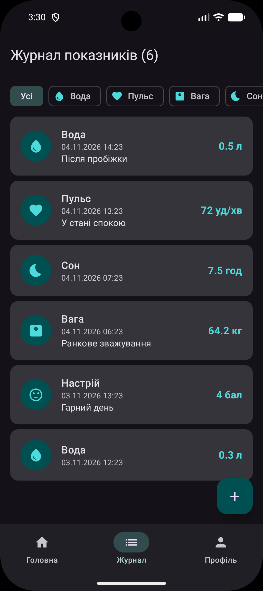
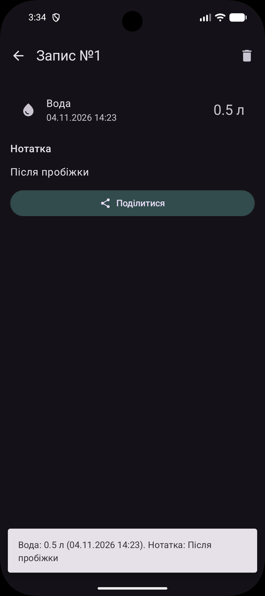
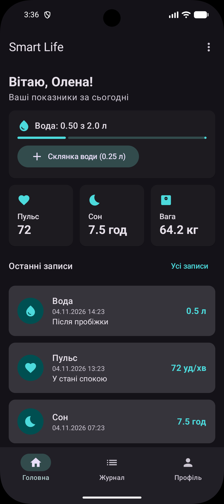
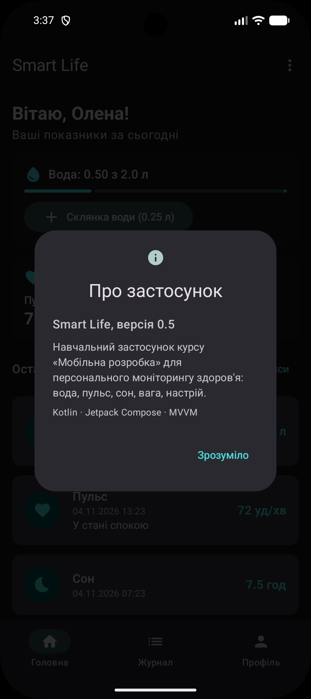
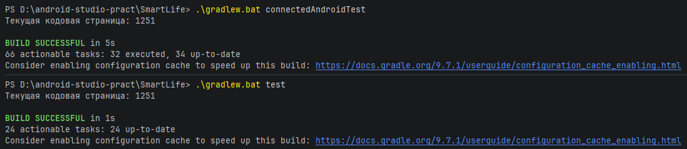

# Android practic

Каркас Android-проєкту для практичних робіт з мобільної розробки на Kotlin і Jetpack Compose.

Гілка `main` містить лише заготовку: шаблон **Empty Activity** з налаштованою Gradle-збіркою і прикладами тестів. Кожна практична робота виконується в окремій гілці:

| Гілка | Робота |
|---|---|
| `lab-01-first-app` | Основи Kotlin (KotlinBasics) і перший Compose-застосунок з лічильником (HelloMobile) |
| `feature/task-2.6` | Розділ 2: інтерфейс, стан і архітектура — Smart Life 0.5 (SmartLife) |

## Структура

```
HelloMobile/
├── settings.gradle.kts          # назва проєкту і список модулів
├── build.gradle.kts             # кореневий файл збірки (плагіни)
├── gradle/libs.versions.toml    # версії бібліотек і плагінів
├── gradlew, gradlew.bat         # Gradle Wrapper
└── app/
    ├── build.gradle.kts         # налаштування застосунку і залежності
    └── src/
        ├── main/                # код застосунку, ресурси, AndroidManifest.xml
        ├── test/                # unit-тести (запускаються на комп'ютері)
        └── androidTest/         # інструментальні тести (на емуляторі або пристрої)
```

## Як запустити

**Android Studio:** **File → Open**, вибрати папку `HelloMobile`, дочекатися синхронізації Gradle і натиснути **▶ Run**.

**Командний рядок (Windows), з папки `HelloMobile`:**

```bat
gradlew.bat assembleDebug          :: зібрати APK
gradlew.bat installDebug           :: встановити на емулятор або пристрій
```

## Тести

```bat
gradlew.bat test                   :: unit-тести (app/src/test)
gradlew.bat connectedAndroidTest   :: інструментальні тести, потрібен запущений емулятор або пристрій
```

В Android Studio тест можна запустити кнопкою **▶** біля класу або методу тесту.

## Версії

| Що | Версія |
|---|---|
| Kotlin | 2.2.10 |
| Android Gradle Plugin | 9.4.1 |
| Gradle | 9.6.0 |
| Jetpack Compose BOM | 2025.08.00 |
| compileSdk / targetSdk | 37 |
| minSdk | 24 |

---

# Практичне завдання 2.6 — Smart Life 0.5

Розділ 2 «Інтерфейс, стан і архітектура застосунку» (лабораторні роботи 3–4). Проєкт — папка [`SmartLife`](SmartLife).

## Опис реалізованого функціоналу

Створено каркас застосунку Smart Life на Jetpack Compose з архітектурою MVVM: екран входу з перевіркою полів, головний екран з підсумками дня і лічильником води, журнал показників з діалогом додавання, екран деталей з видаленням і профіль, нижня панель навігації та типобезпечні маршрути (підрозділи 2.2–2.4). До нього додано три практичні завдання з таблиці 2.6: кнопку «Поділитися» зі Snackbar і пункт меню «Про застосунок» з діалогом, фільтр журналу за типом запису на чипах (`StateFlow<RecordType?>` у `RecordsViewModel`) і метод репозиторію `observeRecordsByType(type)`, який використовує цей фільтр.

| Завдання | Тема | Що зроблено | Файли |
|---|---|---|---|
| 2.6.1 | Інтерфейс і навігація | Кнопка «Поділитися» на екрані деталей показує Snackbar з текстом запису; пункт «Про застосунок» у меню ⋮ головного екрана (і кнопка в профілі) відкриває `AlertDialog` | `ui/details/RecordDetailsScreen.kt`, `ui/components/AboutDialog.kt`, `ui/home/HomeScreen.kt` |
| 2.6.2 | Стан | `RecordsViewModel` зберігає обраний тип у `MutableStateFlow<RecordType?>` (`null` — усі записи), над списком журналу — ряд `FilterChip` «Усі / Вода / Пульс / Сон / Вага» | `ui/records/RecordsViewModel.kt`, `ui/records/RecordsScreen.kt` |
| 2.6.3 | Архітектура | Метод `observeRecordsByType(type)` в інтерфейсі `RecordRepository` і в `InMemoryRecordRepository`; ViewModel перемикається між `observeRecords()` і `observeRecordsByType()` через `flatMapLatest` | `data/repository/RecordRepository.kt`, `data/repository/InMemoryRecordRepository.kt` |

Додано unit-тести: `InMemoryRecordRepositoryTest` (фільтр за типом, оновлення після додавання, id нового запису і видалення) і `RecordsViewModelTest` (вибір фільтра і скидання на «Усі»).

### Структура

```
SmartLife/app/src/main/java/ua/edu/mobile/smartlife/
├── MainActivity.kt, SmartLifeApplication.kt
├── di/AppContainer.kt                 # ручне впровадження залежностей
├── data/
│   ├── model/HealthRecord.kt          # RecordType, HealthRecord, форматування, shareText()
│   ├── FakeData.kt                    # тестові записи
│   └── repository/                    # RecordRepository + InMemoryRecordRepository
└── ui/
    ├── SmartLifeApp.kt                # NavHost + нижня панель
    ├── AppViewModelProvider.kt        # фабрика ViewModel
    ├── navigation/Routes.kt           # @Serializable маршрути
    ├── components/                    # RecordCard, AboutDialog
    ├── auth/, home/, records/, details/, profile/
    └── theme/
```

### Як запустити

**Android Studio:** **File → Open** → папка `SmartLife` → дочекатися Gradle Sync → **▶ Run**. Увійти з будь-якими непорожніми логіном і паролем.

**Командний рядок (Windows), з папки `SmartLife`:**

```bat
gradlew.bat assembleDebug          :: зібрати APK
gradlew.bat testDebugUnitTest      :: unit-тести
```

## Демонстрація роботи

| | |
|---|---|
| Журнал без фільтра (чип «Усі») |  |
| Фільтр «Пульс» — лише записи пульсу |  |
| Екран деталей: Snackbar після «Поділитися» |  |
| Меню ⋮ на головному екрані |  |
| Діалог «Про застосунок» |  |
| Unit-тести пройдено |  |

## Відповіді на контрольні питання (розділ 2.7)

**1. Чим декларативний UI відрізняється від імперативного?**
В імперативному підході розробник сам знаходить елементи (`findViewById`) і вручну змінює їх: текст, видимість, списки. У декларативному (Jetpack Compose) описується, як має виглядати екран для поточних даних, а при зміні даних Compose сам повторно викликає потрібні функції (рекомпозиція). Коду менше, і екран не може розійтися з даними.

**2. Для чого потрібні модифікатори і чи важливий їх порядок?**
`Modifier` — ланцюжок налаштувань розміру, відступів, фону, рамки й реакції на натискання елемента. Порядок важливий, бо модифікатори застосовуються послідовно: `padding(16.dp).background(Gray)` дає фон усередині відступу, а `background(Gray).padding(16.dp)` — фон разом з відступом.

**3. Чому для довгих списків використовують LazyColumn?**
`LazyColumn` створює і компонує лише ті елементи, які видно на екрані, і перевикористовує їх під час прокручування. `Column` створив би одразу всі елементи, що для довгого списку марнує пам'ять і час. Параметр `key` допомагає Compose не перемальовувати зайві елементи при додаванні чи видаленні.

**4. Як передати аргумент між екранами в Navigation Compose?**
Маршрут описують `@Serializable data class` з полем-аргументом, наприклад `RecordDetailsRoute(val recordId: Long)`, і переходять через `navController.navigate(RecordDetailsRoute(id))`. На екрані призначення аргумент читають через `backStackEntry.toRoute<RecordDetailsRoute>()` або у ViewModel через `savedStateHandle.toRoute<...>()`. Тип аргументу перевіряє компілятор.

**5. Що робить popUpTo?**
`popUpTo(маршрут)` під час переходу видаляє зі стеку (back stack) екрани до вказаного маршруту; з `inclusive = true` видаляється і він сам. У Smart Life після входу `popUpTo(LoginRoute) { inclusive = true }` прибирає екран входу, тому «Назад» на головному екрані закриває застосунок, а не повертає до форми входу.

**6. Чим remember відрізняється від rememberSaveable?**
`remember` зберігає значення між рекомпозиціями, але втрачає його при перестворенні Activity (поворот, зміна мови). `rememberSaveable` додатково зберігає значення в `Bundle`, тому воно переживає поворот і тимчасове знищення процесу. У проєкті відкрите меню — `remember`, текст у полях діалогу — `rememberSaveable`.

**7. Чому ViewModel переживає поворот екрана?**
ViewModel зберігається у `ViewModelStore`, який система не знищує під час зміни конфігурації: нова Activity отримує той самий екземпляр. ViewModel очищається (`onCleared()`) лише тоді, коли екран закривається остаточно.

**8. Що таке підйом стану?**
Підйом стану (state hoisting) — винесення стану з composable-функції до її викликача: функція отримує значення і лямбду для його зміни як параметри (`records`, `onSelectType`). Така функція не має власного стану, її легко перевикористати, показати в `@Preview` і протестувати (наприклад, `RecordsContent`).

**9. Навіщо розділяти MutableStateFlow і StateFlow?**
Приватний `MutableStateFlow` може змінювати лише ViewModel, а назовні через `asStateFlow()` віддається `StateFlow` тільки для читання. Так екран не може змінити стан напряму і лише надсилає події у ViewModel — це забезпечує односпрямований потік даних.

**10. Чому стан має бути незмінним?**
Compose помічає зміну стану, порівнюючи нове значення зі старим. Якщо змінити список «на місці» (`add`, `remove`), посилання не зміниться і інтерфейс не оновиться. Тому завжди створюється новий об'єкт: `listOf(new) + current`, `filterNot { }`, `copy()`.

**11. Які шари виділяють в архітектурі Android-застосунку?**
UI-шар (екрани Compose і ViewModel) показує стан і обробляє дії користувача. Шар даних (репозиторії і джерела даних: пам'ять, база, мережа) знає, звідки беруться дані. За потреби між ними додають доменний шар з бізнес-логікою (use case).

**12. Навіщо ViewModel залежить від інтерфейсу репозиторію, а не від класу?**
Щоб реалізацію можна було замінити без зміни ViewModel та екранів: зараз це `InMemoryRecordRepository`, у підрозділі 3.3 буде `RoomRecordRepository`. Також у тестах можна підставити тестову реалізацію. Це принцип залежності від абстракцій.

**13. Що таке єдине джерело правди?**
Кожен тип даних має одного власника — репозиторій, а всі екрани спостерігають за ним через `Flow`. Тому дані завжди узгоджені: запис, доданий у журналі, одразу з'являється на головному екрані.

**14. Для чого потрібна фабрика ViewModel?**
Система створює ViewModel сама і за замовчуванням вміє викликати лише конструктор без параметрів. Якщо ViewModel має залежності (репозиторій, `SavedStateHandle`), потрібна `ViewModelProvider.Factory`, яка знає, як їх передати. У проєкті це `AppViewModelProvider.Factory`, що бере репозиторій з `AppContainer`.

**15. Що робить stateIn з WhileSubscribed?**
`stateIn` перетворює холодний `Flow` з репозиторію на гарячий `StateFlow` з початковим значенням (`emptyList()`), прив'язаний до `viewModelScope`. `SharingStarted.WhileSubscribed(5_000)` тримає підписку на джерело, поки є хоча б один підписник, і зупиняє її через 5 с після зникнення екрана. Цих 5 секунд досить, щоб під час повороту екрана підписка не переривалася.
